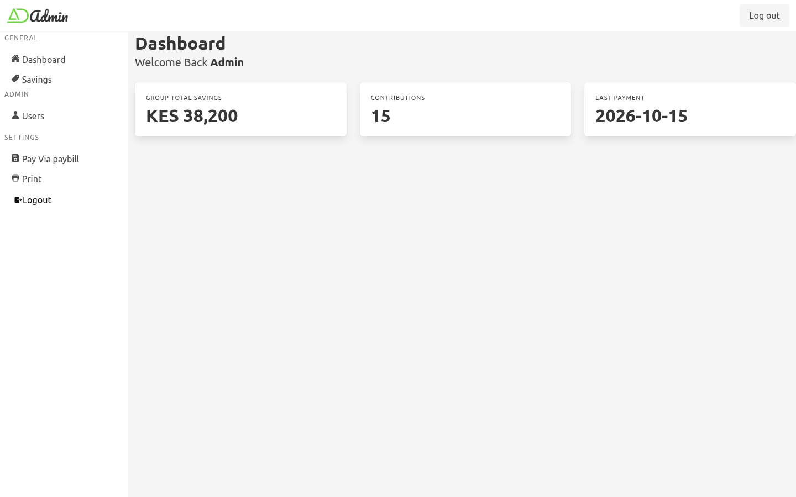
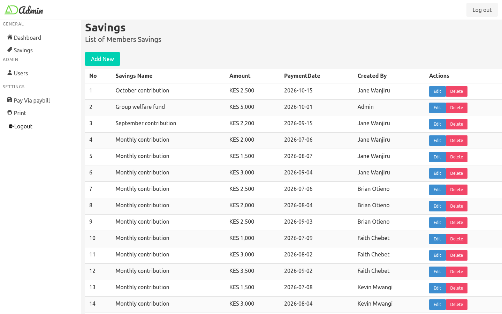
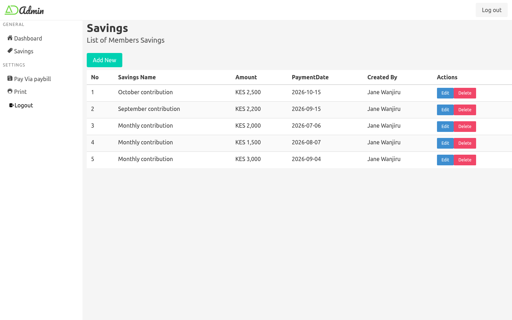
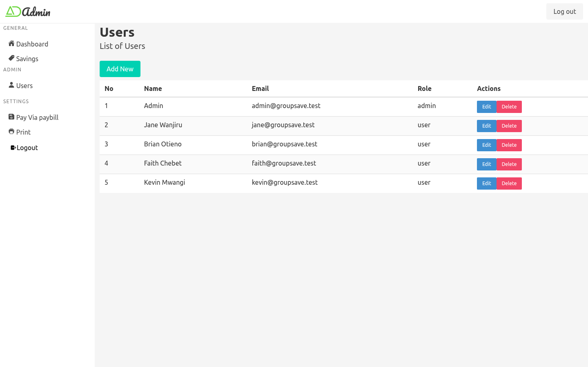
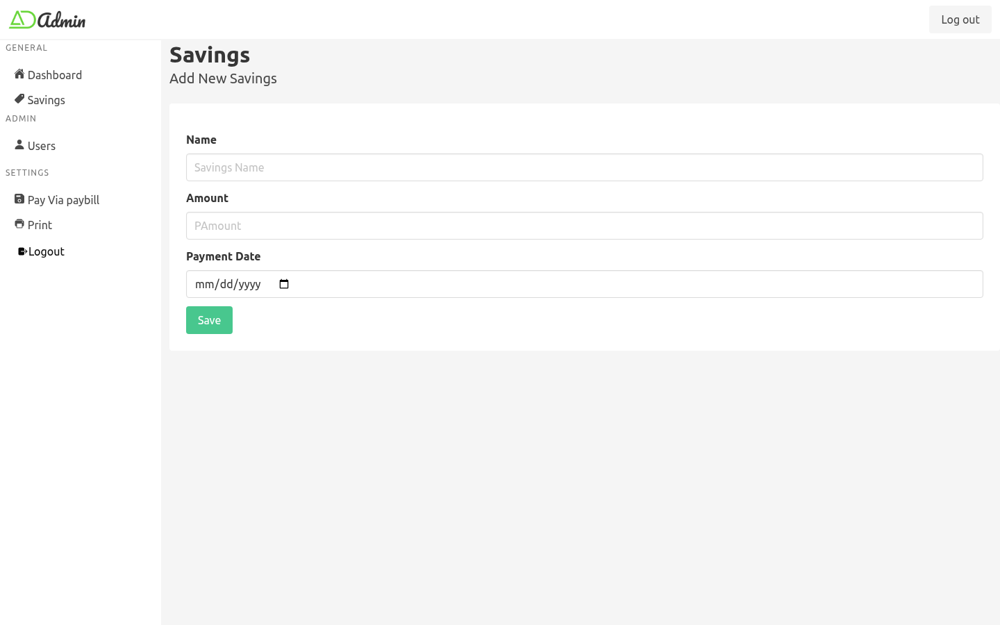

# Group Save

A web app for chamas and savings groups. Members record their monthly contributions and the group admin sees everyone's savings in one place.

I first built this in 2023 with React and Node.js. In October 2026 I came back to it, fixed several bugs, cleaned up security issues and moved the database from MySQL to PostgreSQL.



## Features

- **Login with sessions.** Passwords are hashed with argon2 and the login session is stored in the database.
- **Two roles.**
  - **Admin:** manages members and sees every member's savings.
  - **Member:** sees and manages only their own savings.
- **Savings records.** Add, edit and delete contributions with an amount and payment date.
- **Dashboard.** Shows total savings, the number of contributions and the last payment date.
- **Postman collection.** 16 requests with automated tests in `Backend/postman/`.

## Tech stack

| Part | Tools |
|---|---|
| Frontend | React 18, Redux Toolkit, React Router, Axios, Bulma |
| Backend | Node.js, Express, Sequelize ORM |
| Database | PostgreSQL |
| Testing | Postman / Newman |

## Screenshots

| Admin: all members' savings | Member: only their own savings |
|---|---|
|  |  |

| Admin: manage members | Add a saving |
|---|---|
|  |  |

## How it works

```
React (port 3000)  --axios + session cookie-->  Express API (port 5000)  --Sequelize-->  PostgreSQL
```

- On login, the API saves the user's id in a session. The browser keeps the session cookie.
- Every protected route goes through the `verifyUser` middleware. Admin-only routes also go through `adminOnly`.
- The savings controller checks the role:
  - an admin gets all savings
  - a member only gets rows where `userId` matches their own id

## Running it locally

**Requirements:** Node.js 18+ and PostgreSQL.

1. Create the database:

```sql
CREATE USER group_savings WITH PASSWORD 'choose-a-password';
CREATE DATABASE group_savings OWNER group_savings;
```

2. Start the backend:

```bash
cd Backend
cp .env.example .env      # then fill in the values
npm install
npm run seed              # creates the first admin from ADMIN_EMAIL / ADMIN_PASSWORD
npm run dev               # http://localhost:5000
```

3. Start the frontend:

```bash
cd Frontend
npm install
npm start                 # http://localhost:3000
```

## API

| Method | Endpoint | Who |
|---|---|---|
| POST | `/login` | Anyone |
| GET | `/me` | Logged in |
| DELETE | `/logout` | Logged in |
| GET / POST | `/savings` | Logged in |
| GET / PATCH / DELETE | `/savings/:id` | Owner or admin |
| GET / POST | `/users` | Admin |
| GET / PATCH / DELETE | `/users/:id` | Admin |

To test the API, import `Backend/postman/Group-Save.postman_collection.json` into Postman. Set `adminPassword` in the collection variables, then run the collection.

## What I fixed in the 2026 update

- **Members could not edit their savings.** The update query used a variable that did not exist (`price`), so the request crashed.
- **Wrong endpoints.** The frontend called `/products` instead of `/savings` for edit and delete, and the add form did not send the payment date.
- **CORS was set up twice.** The second setup overrode the first, so the login cookie was not sent with requests.
- **The `.env` file was committed.** Stopped tracking it and added a `.env.example` with the settings the app needs.
- **`node_modules` was committed** (41,000+ files). Added a `.gitignore` and removed them from the repo.
- **Moved from MySQL to PostgreSQL.** Because the app uses Sequelize, this needed only the `pg` driver and a different `dialect`.
- **Added a seed script.** Only an admin can create users, so a fresh install had no way to log in.
